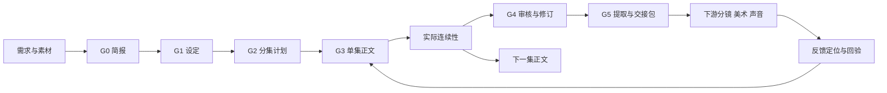

# 剧本生产管线 v2

本管线覆盖从需求到可交付剧本包，以及制作反馈引起的剧本返工。图像、视频、配音和剪辑生产由下游执行；此处定义接收接口，不把它们伪装成已自动化。

## 组成与唯一维护位置

| 层 | 作用 | 唯一来源 |
| --- | --- | --- |
| 执行 | 选择具体工作并创作/审查 | 1 个总入口、6 个阶段入口、30 个子技能，见[目录](subskills.md) |
| 标准 | 判断叙事和生产质量 | [标准](standards.md)、[流程](workflow.md) |
| 内容模板 | 规定输入和交付字段 | [模板入口](../assets/templates.md)及其链接的 10 个独立模板 |
| 项目控制 | 跟踪版本、文件、依赖和问题 | 每项目 project.json，见[数据协议](operations.md) |
| 执行工具 | 初始化、检查、登记、关口与打包 | [pipeline.py](../scripts/pipeline.py)，Python 3.9+ 标准库 |
| 反馈闭环 | 接收问题、定位、返工和回验 | 项目 feedback.md、changes.md、decisions.md |

Skill 决定如何工作；模板规定交付结构；标准判定内容质量；工具发现文件与依赖问题。工具不生成剧情、不自动批准、不访问模型或外部服务。

## 一次运行

### 启动

1. 小型单项任务可只使用子技能及模板章节；需要批量协作和交付时，运行 `init` 建立项目工作区。已有项目不覆盖，按真实产物逐一登记。
2. 读取 project.json、现有内容及用户约束。`status` 展示哪些项目/单集关口还缺内容，选择所需 Skill，不默认从 G0 重做。
3. 新模板不是产物完成。填真实内容后移除未填写标记，使用 `register` 登记文件版本及依赖快照。工具对文本不作完整性/审美判断。

### 每阶段执行

读取输入版本 → 选择子技能 → 在相应模板章节完成任务 → 按标准自查/审稿 → 更新状态/问题 → 登记产物 → 检查阶段关口 → 交棒。

关口结果 `STRUCTURE_READY` 只表示文件与已登记证据可用；创作质量结论必须在报告中给出。G0–G3 可带显式假设交给下一步开发，不要求每个阶段额外向用户申请许可。整阶段完成不能由某一个子技能的完成推断。

## 阶段输入输出契约

| 关口/范围 | 必需登记输出 | 依赖 | 人工内容验收 | 交棒 |
| --- | --- | --- | --- | --- |
| G0/project | brief | 无 | 受众承诺、范围、规格、素材边界及假设明确 | 简报版本与未决项给 G1 |
| G1/project | bible | brief | 因果与结局成立，人物/关系/规则/资产一致 | 设定版本给 G2 |
| G2/project | outline | brief、bible | 集数容量、变化、回报、伏笔与跨集计划成立 | 指定集的计划给 G3 |
| G3/EPxxx | script、continuity | script 依赖 bible、outline；后集另依赖前集 continuity；本集 continuity 依赖 script | 可演可听、计时合理，实际状态有正文证据 | 正文和实际台账给 G4 |
| G4/EPxxx | review | script、continuity | 六维检查范围明确，问题定位与复核有证据 | review 须登记 reviewed/locked；通过后登记 script 的审核依据 |
| G5/EPxxx | handoff；export 可选 | handoff 依赖 script、review、bible、continuity；export 依赖 script、handoff | 逐句、场次、资产及首尾状态与正文一致 | 正文至少 reviewed；未锁定包用于预制作 |

默认 `episodes` 列出本次纳入连续生产的集，按制作叙事顺序排列，续集必须承接上一集实际状态。选集剧等不存在连续性的项目应先显式调整管线设计，不通过伪造前集台账绕过检查。一次交付某集会包含必要的前集状态依赖链；不会打包项目中的无关文件。

## 状态、权限与质量

产物状态是 draft / reviewed / locked / superseded；阶段关口是结构结果，二者分开。登记 reviewed 需审稿范围和报告位置，locked 需实际确认依据；工具只能检查依据非空，不能证明批准真实。

审核报告记录叙事证据，project.json 的 issues 是问题状态的机器来源。审核子技能同步问题 ID；P0 不可豁免，P1 只有修复或明确接受后才不阻断对应交棒，P2 可保留。已解决/接受的问题绑定所影响产物的版本，版本改变前先重新打开问题，复核后再关闭。

单个写作者可以兼任创作与自审，须明确“作者自审”。独立审稿只有实际由独立审稿者完成才可记录。发行合规、版权判断与商业表现不由本管线自动认证。

## 单集、批次和恢复

- 全季计划维护在 outline.md，实际状态按集放 continuity/。禁止本集剧本依赖本集实际台账：它是本集正文的结果；下一集才消费它。
- 每批末尾记录输入版本、覆盖集、末尾状态、未回收伏笔、下批入口及需回读的位置。批次大小服从请求和审稿容量，不强制完整运行 30 个子技能。
- 中断后先跑 `check` 和 `status`，读取最近输入/产物与未决问题。不存在明确自审记录的产物保留 draft。
- 工具按单写入者运行。并行创作可写不同产物，但 project.json 的登记由一位操作者串行执行；原子写入可防止半文件，不能提供多人事务隔离。

## 变更、失效与下游返工

1. 收到变更或反馈，记录反馈版本、集场/对白/资产位置与证据，先判断属于剧情、分镜实现、美术参考还是声音/剪辑。
2. 未解决问题登记 issues。修订只改变本次请求与必要一致性内容；锁定旧文件保留，新稿使用新路径和版本。
3. 上游文件修改会让其哈希失效；登记新版本后，依赖旧快照的产物仍为待复核，并向下传播。不能仅刷新全部哈希假装修复。
4. 按依赖顺序真实检查、修订。即便内容不变，依赖版本变化也要新修订号和 `--note` 说明复核结果；失效旧审核不能直接用于新稿。
5. 重新提取对白/资产/JSON，再打一个新的包。旧包保留，向下游交接时说明替代关系；本工具不自动发送。
6. 回验实测时长、缺镜、素材状态与对应问题。若下游实际未反馈，保持“待验证/未接收”，不自动关闭。

## 对现有项目的迁移

保留原创作文件与锁定旧版；先把 30 个子技能的产物映射到真实章节，再登记 brief→bible→outline→script→continuity→review→handoff。无需改名为模板路径。

原 continuity.md 可继续作为阅读索引，但进入自动管线应拆出各集实际状态文件，计划伏笔迁到 outline.md；不要把同一整季文件注册为多个独立集的产物。原 review/handoff 文件名可保持不变。

从仓库复制技能时，运行工具和模板都在总入口目录内；按原有套件依赖一起分发，不依赖本机绝对路径。

## 0.2.0 多集控制

恢复先 next，批次末 checkpoint，扩展集数用 episodes；问题和反馈用 CLI 维护唯一状态。连续性记录按[结构化记录](structured-records.md)随正文证据登记，索引按需重建。范围/全季审查见[审核方法](season-review.md)。改稿先 impact，真实复核后刷新版本；交接先 parity，bundle 保存包身份，receipt/measure 仅登记实际收到的证据。详见[操作手册](operations.md)。
